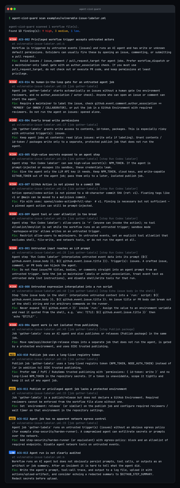

# agent-cicd-guard

面向 **接入 CI/CD 的 AI Agent** 的安全检查清单，以及一个轻量的静态扫描器，重点覆盖 GitHub Actions。

2026 年 11 月，Depi 的研究人员披露：OpenAI Codex 仓库里一个给 issue 自动打标签的 workflow，会把不受信任的 issue 正文直接塞进 Agent 的 prompt。一次提示注入被一路串到可能影响官方 npm 包 `@openai/codex` 发布权限的程度。OpenAI 已修复；Depi 写明没有恶意版本流出。这类写法并不罕见——任何人开一个 issue 就能触发 workflow，再把标题和正文交给模型。

这个仓库把这类问题收成两样东西：

- 一份评审时能对照的检查清单
- 一个扫描 `.github/workflows/*.yml` 里危险模式的 Python 命令行工具

这是防御向工具，不包含利用代码，也不提供攻击演示。

仓库地址：<https://github.com/songchunhui545-collab/agent-cicd-guard>

English README: [README.md](README.md)。完整清单见 [CHECKLIST.zh-CN.md](CHECKLIST.zh-CN.md) / [CHECKLIST.md](CHECKLIST.md)。

## 演示

扫描仓库自带的反面示例（[`examples/vulnerable-issue-labeler.yml`](examples/vulnerable-issue-labeler.yml)）：



## 快速开始

需要 Python 3.9+ 和 [PyYAML](https://pyyaml.org/)。

```bash
python -m venv .venv
source .venv/bin/activate  # Windows: .venv\Scripts\activate
pip install -e ".[dev]"

# 扫描仓库根目录、workflows 目录，或单个文件
agent-cicd-guard scan .
agent-cicd-guard scan tests/fixtures/vulnerable-issue-labeler.yml

# 机器可读输出
agent-cicd-guard scan . --format json
agent-cicd-guard scan . --format sarif -o reports/agent-cicd-guard.sarif
```

出现至少一条 **high** 级别发现时，进程退出码为 `1`（可用 `--fail-on medium|low|info|never` 调整）。路径或用法错误时退出码为 `2`。

```bash
pytest   # 运行自带单元测试
```

示例 GitHub Actions 工作流：[`.github/workflows/agent-cicd-guard.yml`](.github/workflows/agent-cicd-guard.yml)。

## 用法

```
agent-cicd-guard scan [path] [--format text|json|sarif] [-o FILE] [--fail-on high]
```

| 参数 | 含义 |
| --- | --- |
| `path` | 仓库根目录（自动找 `.github/workflows/`）、workflows 目录，或单个 YAML。默认是 `.`。 |
| `--format` | `text`（默认）、`json`，或用于 code scanning 的 SARIF 2.1.0。 |
| `-o, --output` | 把报告写到文件。 |
| `--fail-on` | 使 CI 失败的最低严重级别。默认：`high`。 |

扫描器会识别常见 Agent action（`openai/codex-action`、`anthropics/claude-code-action`、`google-github-actions/run-gemini-cli`、GitHub Copilot 相关 action 等），以及 `env` / `with` 里的 LLM API 密钥，再套用下面的规则。

## 规则列表

| ID | 默认级别 | 检查内容 |
| --- | --- | --- |
| ACG-001 | high | 不受信任的 issue / PR / 评论字段被插进 Agent prompt |
| ACG-002 | high | 外部人员能触发的高权限事件（`issues`、`issue_comment`、`pull_request_target`、`workflow_run` 等），并同时跑 Agent 或拥有写权限 |
| ACG-003 | medium | 缺少默认的 `permissions:` 块 |
| ACG-004 | high / medium | 过宽的写权限（`contents`、`id-token`、`packages`、`actions` 或 `write-all`） |
| ACG-005 | high | 高价值密钥（`NPM_TOKEN`、云厂商密钥、可写的 `GITHUB_TOKEN` 等）对 Agent 步骤可见，包括 job / workflow 级 `env` |
| ACG-006 | high | Agent 任务和发布任务写在同一个 job（或不受信任的 Agent job 持有发布权限） |
| ACG-007 | medium（Agent action 为 high） | `uses:` 没有钉死到 40 位 commit SHA |
| ACG-008 | high | 在 `run:` 脚本里直接展开 `${{ github.event.* }}` |
| ACG-009 | high | `allow-users: "*"`、跳过权限检查，或在不受信任的触发器上允许 shell / 写文件类工具 |
| ACG-010 | medium | 发布 job 使用长期有效的仓库令牌，而不是 OIDC 受信发布 |
| ACG-011 | medium | 发布或高权限 Agent job 没有配置 GitHub Environment |
| ACG-012 | medium | 不受信任触发器上的 Agent job 看不到出站网络限制 |
| ACG-013 | low | Agent 运行过程没有明显把日志 / 产物留下来做审计 |
| ACG-014 | high | Agent 在不受信任的事件上自动启动，没有人工门禁 |

ACG-000 留给无法解析的 YAML（按 high 处理，让 CI 选择失败关闭）。

## 示例

- [`examples/vulnerable-issue-labeler.yml`](examples/vulnerable-issue-labeler.yml) —— 浓缩的 issue 打标签反面教材（不是对任何私有 workflow 的复制，也不是利用代码）。
- [`examples/vulnerable-pr-target.yml`](examples/vulnerable-pr-target.yml) —— `pull_request_target` 加上脚本注入。
- [`examples/safe-manual-labeler.yml`](examples/safe-manual-labeler.yml) —— 维护者手动 `workflow_dispatch`、钉死 SHA、最小权限、工具白名单、受保护环境、出站限制、审计产物。
- [`examples/safe-ci.yml`](examples/safe-ci.yml) —— 普通 CI，没有 Agent。

背景文章（事件、攻击链的高层说明、如何用这个工具）：

- [articles/article-zh.md](articles/article-zh.md)
- [articles/article-en.md](articles/article-en.md)

## 局限

- 这是对 workflow YAML 的静态分析，不能证明一个 workflow 是安全的；它认不出的 Agent 调用方式也会漏报。
- 看不到组织级的 GITHUB_TOKEN 默认权限、Environment 是否真的要求审批、以及分支保护。ACG-011 只检查有没有声明 `environment:` 名称。
- 把 action 钉到 SHA 是必要的，但不够。Codex 的 issue-labeler 当时已经钉了 `openai/codex-action` 的 commit；真正的问题是不受信任的输入，再加上 Agent 权限过宽。
- v0.1 不覆盖 GitLab CI、CircleCI、Jenkins 或各云厂商流水线。
- 扫描结果是给人做 review 用的提示，不是合规认证。

## 事件来源

文档和文章里关于 Codex 事件的陈述，来自 Depi 于 2026 年 11 月 11 日发布的公开文章：[《Backdooring the next release of Codex through GitHub Action pipeline exploit chaining》](https://depi.security/blog/20261111-backdooring-codex/)。下载量、奖金和日期，只采用该文或其他已注明的公开来源，不另行编造。

## 许可证

[MIT](LICENSE)。Copyright (c) 2026 agent-cicd-guard contributors。

本项目与 OpenAI、GitHub、Depi 均无隶属关系。
